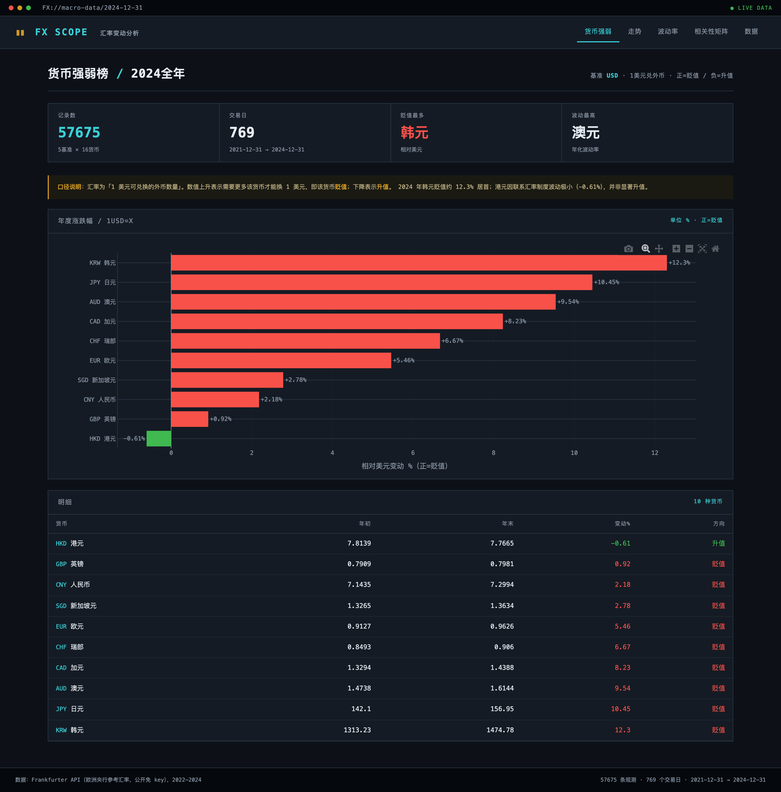
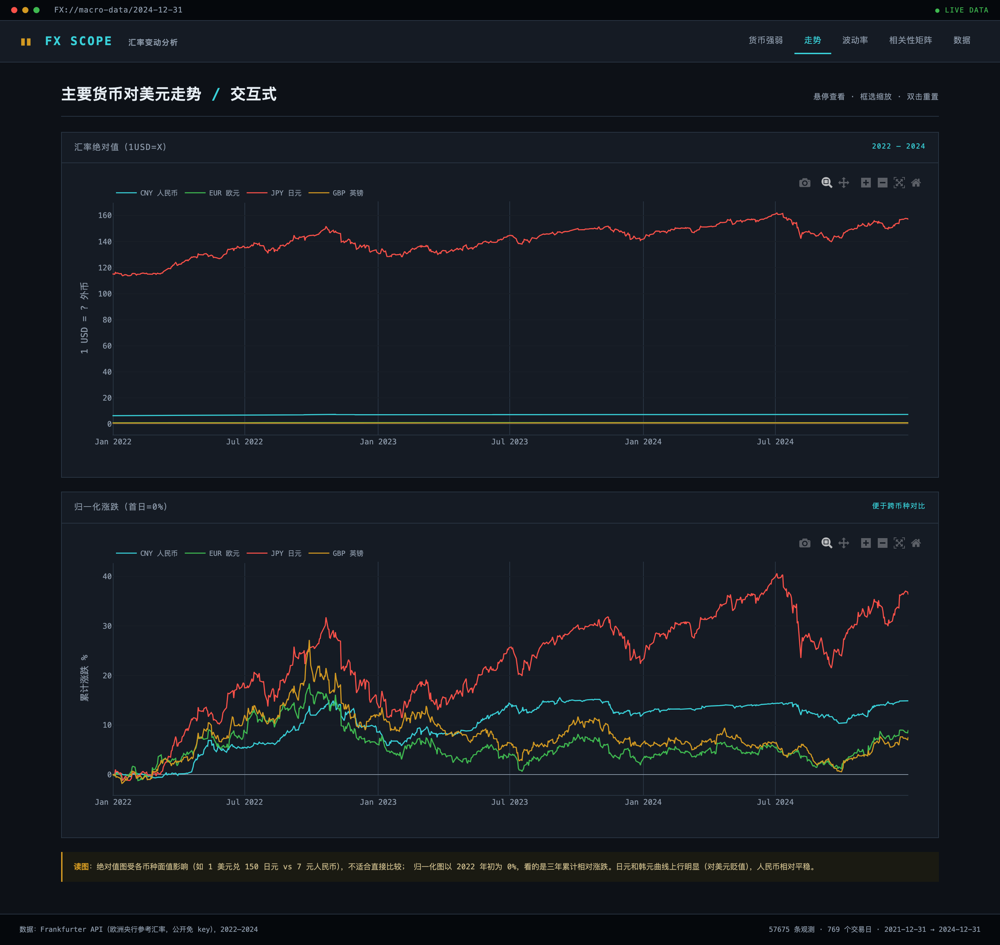
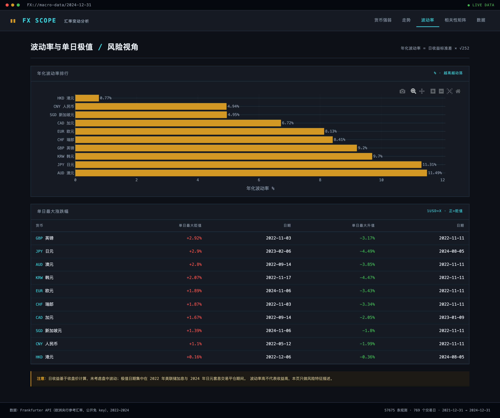
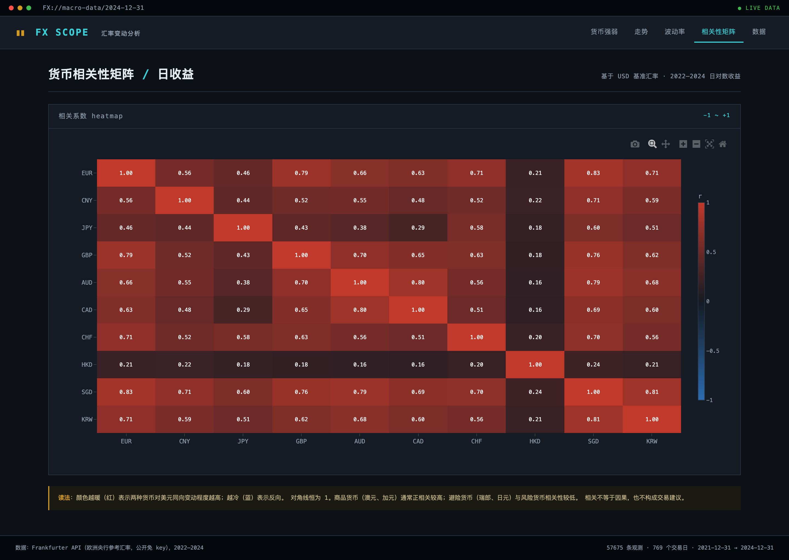
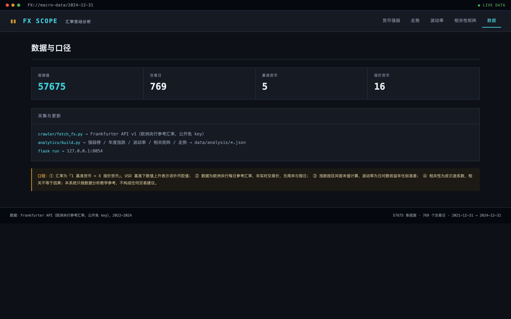

# 054 基于Frankfurter公开数据的汇率变动分析系统-设计展示

> **代码有偿获取 可接受定制 微信联系方式: csbysj2020 或 ACE2487，备注(BS)**

> **完整源码与全套文档 · 在线自助获取 >>> [https://mbd.pub/o/bread/YZaWmJlrZQ==](https://mbd.pub/o/bread/YZaWmJlrZQ==)**

> **成品页（功能介绍 / 更多选题）>>> [https://bishe.suilang.net/products/fx-scope](https://bishe.suilang.net/products/fx-scope)**

> 

> 

## 视频

> **点击查看 >>> [https://www.bilibili.com/video/BV1uayWzyEeE/](https://www.bilibili.com/video/BV1uayWzyEeE/)**

## 项目简介

差异化架构：Flask + Plotly.js 交互式金融图表（离线可用），深色终端风格，区别于常规 Django+ECharts 看板。采集 Frankfurter 公开汇率（欧洲央行参考汇率）57675 条观测、769 交易日、5 基准×16 报价（2022-2024）。围绕汇率主题做货币强弱、走势、年化波动率、单日极值、相关性矩阵与归一化走势，正确处理『USD 基准数值上升=外币贬值』口径。5 个页面，69 秒演示视频。只做数据分析教学参考，不构成交易建议。

汇率是宏观经济的重要观测指标。

本项目设计并实现了一套基于 Frankfurter 公开数据的汇率变动分析系统：通过 Frankfurter API（欧洲央行参考汇率）采集 5 种基准货币 × 16 种报价货币 × 2022–2024 年共 57675 条观测，结构化后从货币强弱、年度涨跌、年化波动率、单日极值、货币相关性与归一化走势六个维度分析；特别处理了「USD 基准下数值上升代表该外币贬值」的汇率口径问题。

系统采用 Flask + Plotly.js 交互式金融图表与深色终端风格界面（区别于常规 Django+ECharts 看板），实现货币强弱、走势、波动率、相关性矩阵与数据说明 5 个页面，Plotly 本地化离线可用。

本仓库为**设计展示**：包含项目说明、技术架构、实验结果与运行截图；完整源码、任务书、开题报告、毕业论文与使用说明可通过上方链接自助获取，成品页可查看更多选题，也可联系微信咨询定制。

## 功能特性

1. 差异化技术栈：Flask + Plotly.js（本地化离线可用），不套用 Django+ECharts 模板

2. 差异化页面：货币强弱/走势/波动率/相关性矩阵/数据说明 5 页，没有通用总览大屏

3. 真实采集：Frankfurter API（ECB 参考汇率）57675 条观测 / 769 交易日 / 5 基准×16 报价

4. 汇率口径：USD 基准下数值上升=该外币贬值，页面明确说明（韩元2024贬值12.3%）

5. 金融统计：年化波动率=日收益标准差×√252，澳元居前

6. 相关性矩阵：Plotly heatmap 展示货币日收益联动，相关不等于因果

7. 交互式图表：Plotly 缩放、悬停十字光标，深色金融终端视觉

8. 数字单一来源：页面与论文读 data/stats.json，重跑采集→分析即可同步

9. 合规边界：参考汇率非实时成交价、不构成任何交易建议

## 技术架构

| 项目 | 说明 |
| --- | --- |
| 编程语言 | Python 3.8+ |
| Web 框架 | Flask（轻量路由） |
| 图表 | Plotly.js（本地化交互图表） |
| 统计计算 | NumPy |
| 样本规模 | 57675 观测 / 769 交易日 / 16 货币 |
| 运行端口 | http://127.0.0.1:8054 |
| 说明 | 无管理端，数据直读 JSON，无需数据库 |

## 目录结构

以下为完整交付版的结构（本仓库仅作设计展示）：

```
fx-scope/
├── analytics/
│   ├── __init__.py
│   └── build.py
├── crawler/
│   ├── __init__.py
│   └── fetch_fx.py
├── data/
│   ├── analysis/
│   │   ├── corr.json
│   │   ├── extremes.json
│   │   ├── moves.json
│   │   ├── overview.json
│   │   ├── trends.json
│   │   ├── volatility.json
│   │   └── yearly.json
│   ├── processed/
│   │   └── rates.csv
│   ├── raw/
│   │   ├── fx_CNY_2022.json
│   │   ├── fx_CNY_2023.json
│   │   ├── fx_CNY_2024.json
│   │   ├── fx_EUR_2022.json
│   │   ├── fx_EUR_2023.json
│   │   ├── fx_EUR_2024.json
│   │   ├── fx_GBP_2022.json
│   │   ├── fx_GBP_2023.json
│   │   ├── fx_GBP_2024.json
│   │   ├── fx_JPY_2022.json
│   │   ├── fx_JPY_2023.json
│   │   ├── fx_JPY_2024.json
│   │   ├── fx_USD_2022.json
│   │   ├── fx_USD_2023.json
│   │   └── fx_USD_2024.json
│   └── stats.json
├── fxapp/
│   └── app.py
├── static/
│   ├── css/
│   │   └── style.css
│   └── js/
│       ├── common.js
│       └── plotly.min.js
└── …
```

## 数据与实验结论

- 实验显示 2024 年韩元对美元贬值约 12.3%、日元约 10.45%，澳元年化波动率居前。
- 差异化页面：货币强弱/走势/波动率/相关性矩阵/数据说明 5 页，没有通用总览大屏
- 真实采集：Frankfurter API（ECB 参考汇率）57675 条观测 / 769 交易日 / 5 基准×16 报价
- 汇率口径：USD 基准下数值上升=该外币贬值，页面明确说明（韩元2024贬值12.3%）

## 交付内容

1. 完整源码（Flask 应用 + 采集器 + 分析引擎 + 5 页面）
2. 真实数据（raw JSON + rates.csv + analysis JSON）
3. 一键启动脚本
4. 任务书与开题报告（Word）
5. 毕业论文（Word 七章制）
6. 二次开发说明（Word+md）
7. 5 张截图 + 封面 + 69s 演示视频

## 常见问题

**为什么技术栈和其他成品不一样？**

这是刻意做的差异化：用 Flask + Plotly.js 交互式金融图表替代 Django+ECharts，体现针对不同数据主题的独立设计。

**数据实时吗？**

是欧洲央行每日参考汇率，非实时成交价，无周末假日，页面有口径说明。

**汇率升降怎么理解？**

1美元=X外币，数值上升=该外币贬值。韩元2024从1313到1475，即贬值12.3%。

**Plotly 能离线用吗？**

能，plotly.min.js 已本地化到 static/js/。

**能作为交易参考吗？**

不能。本系统只做数据分析教学参考，不构成任何交易建议。

## 截图






